# Personalized Recommendation System

Experiment 4 of **24CS2506 - Building Applications using GPT-4**.

A modular personalized recommendation system that runs entirely on a local
machine using **Llama 3.2** served by **Ollama**. It collects a user profile,
analyzes preferences, builds a prompt, generates recommendations with a
suitability score and reason for each item, ranks them, explains them, refines
them from user feedback, and saves the results to a file. An intent detector
routes free-text requests to the correct module.

## Setup

```bash
ollama pull llama3.2
ollama serve

python3 -m venv .venv && source .venv/bin/activate
pip install -r requirements.txt
```

## Run

```bash
python main.py
```

## Modules

| File | Responsibility |
|------|----------------|
| `input_module.py` | Collects name, age, background, interests, skill level, category, goal, item count |
| `profile_module.py` | Stores/displays the profile and performs the preference analysis |
| `prompt_module.py` | Builds the prompt from the profile and the analysis |
| `recommendation_module.py` | Generates recommendations with name, score and reason |
| `ranking_module.py` | Ranks the recommendations by suitability score |
| `explanation_module.py` | Explains why each recommendation suits the user |
| `feedback_module.py` | Refines the list from user feedback |
| `intent_module.py` | Detects GENERATE / REFINE / SHOW_PROFILE / EXPLAIN / SAVE / EXIT |
| `save_module.py` | Writes the ranked results to `outputs/recommendations.txt` |
| `utils.py` | Ollama client, formatting and file handling |
| `main.py` | Menu driven application with continuous interaction |

## System architecture

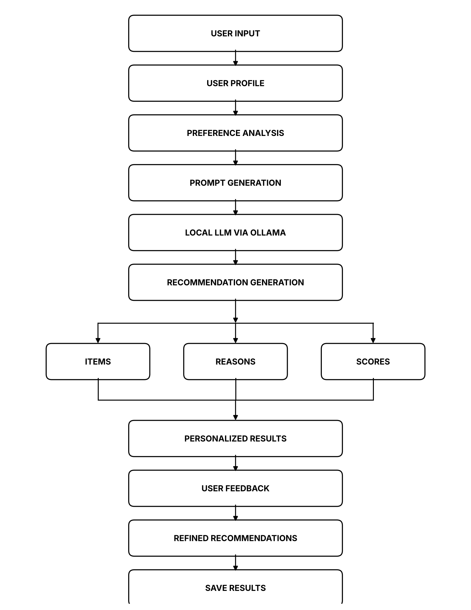

## Output screenshots

| | |
|---|---|
| Home screen | 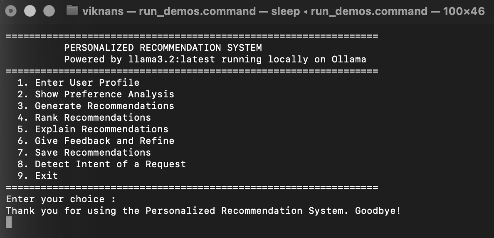 |
| User profile input | 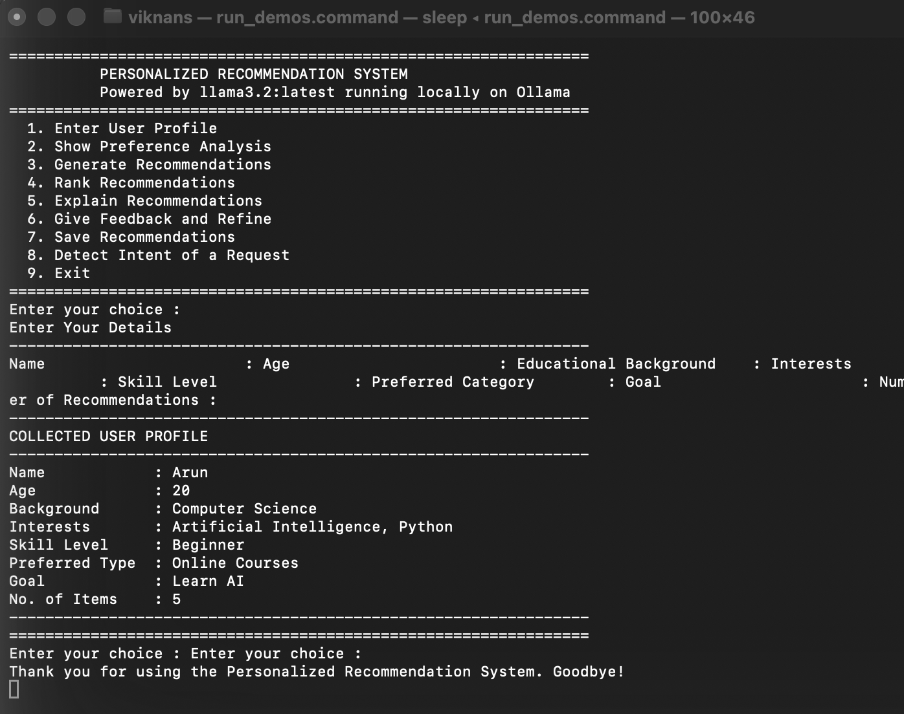 |
| Collected profile | 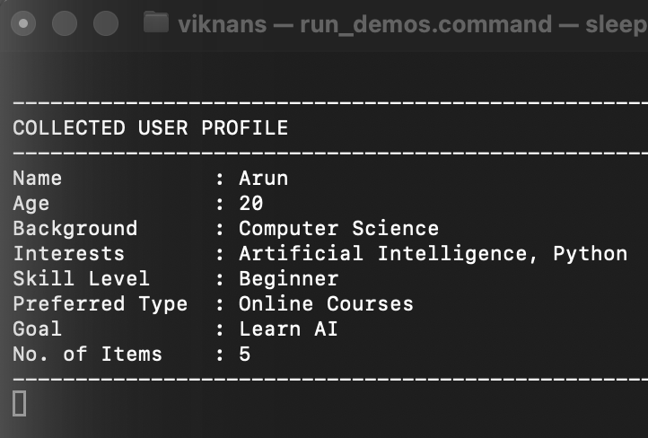 |
| Preference analysis | 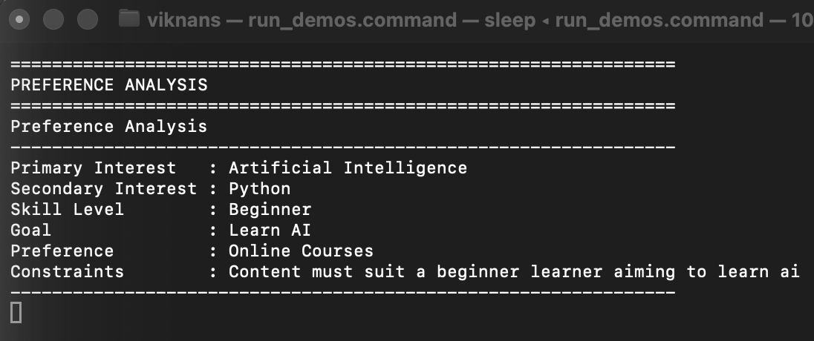 |
| Prompt generation | 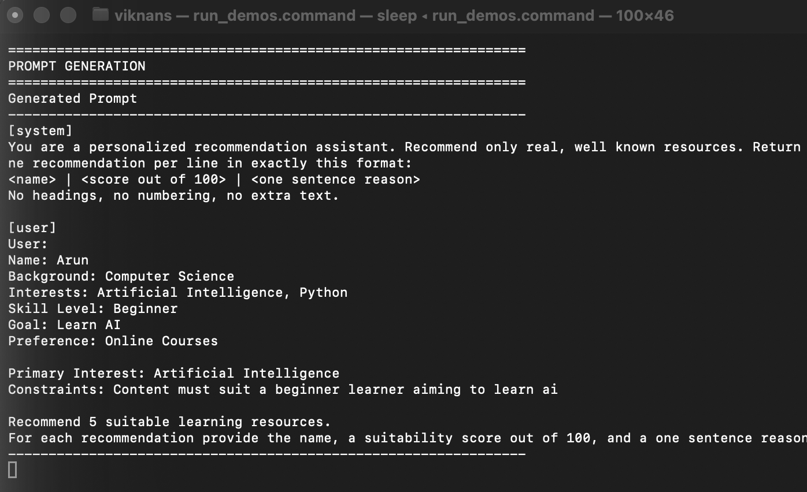 |
| Recommendations | 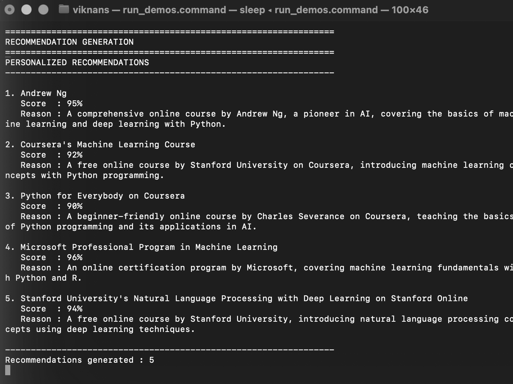 |
| Ranking | 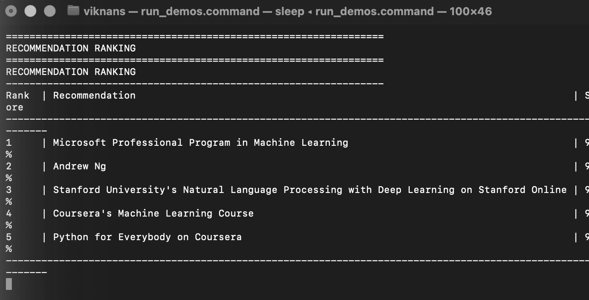 |
| Explanation | 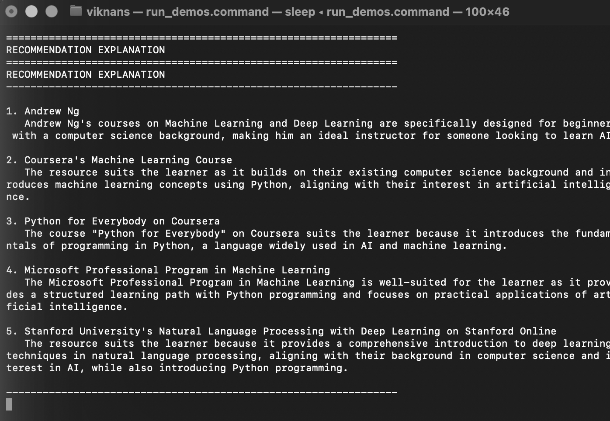 |
| User feedback | 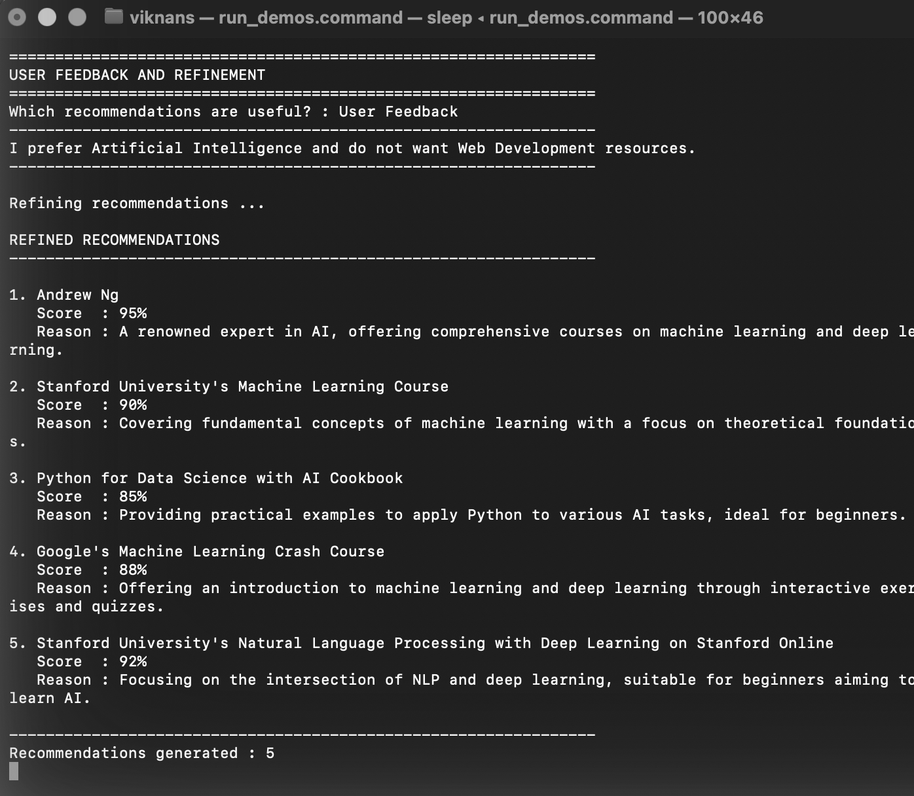 |
| Refined recommendations | 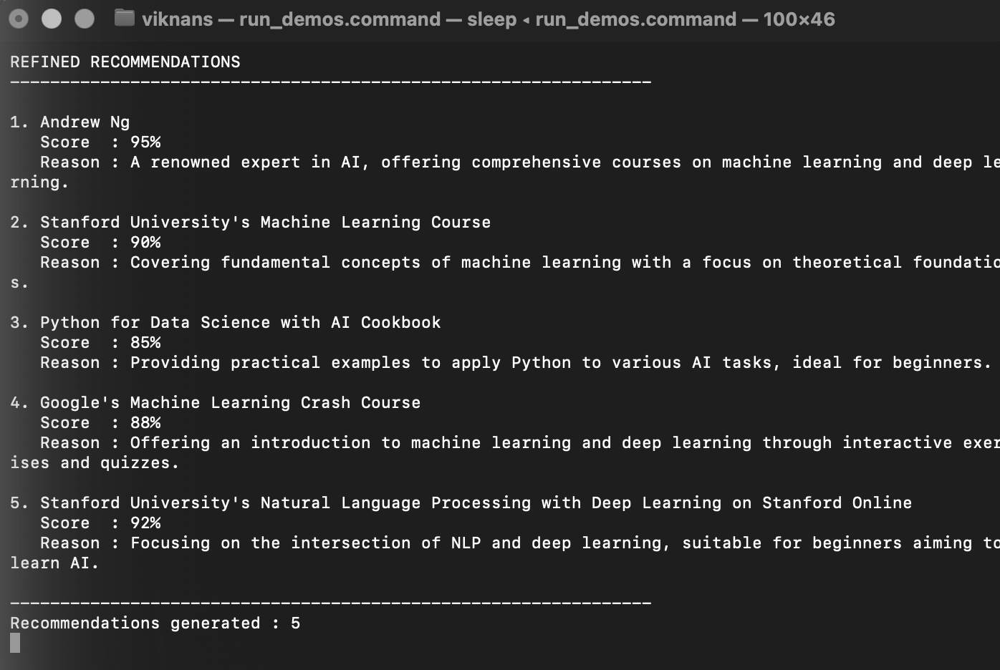 |
| Intent detection | 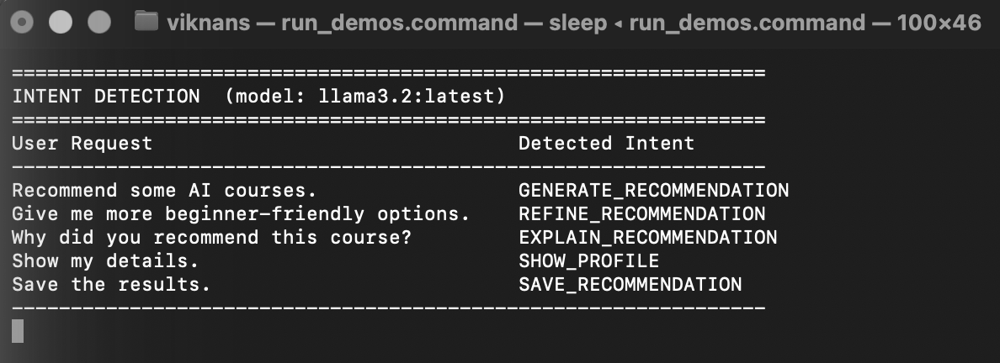 |
| Saved successfully | 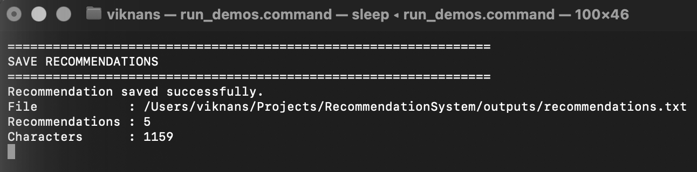 |
